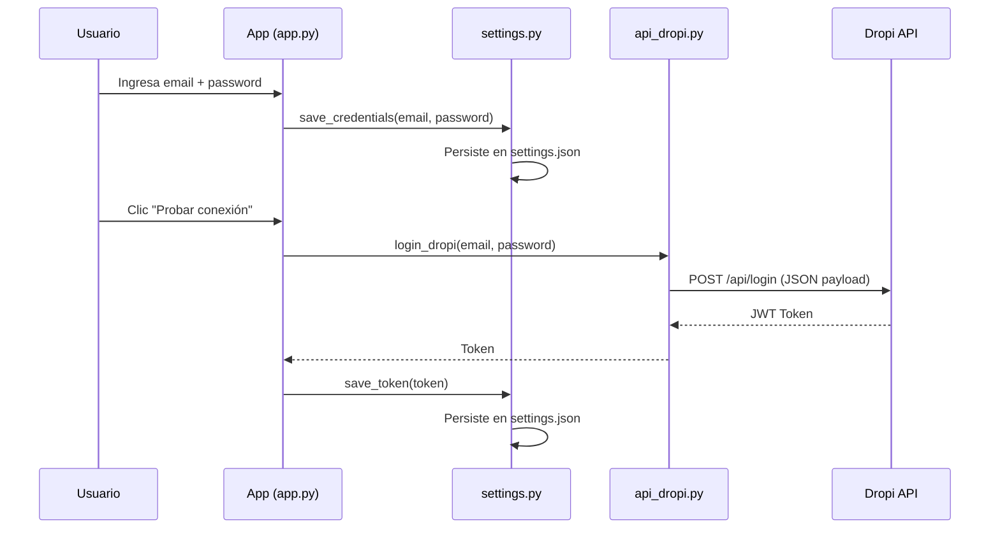
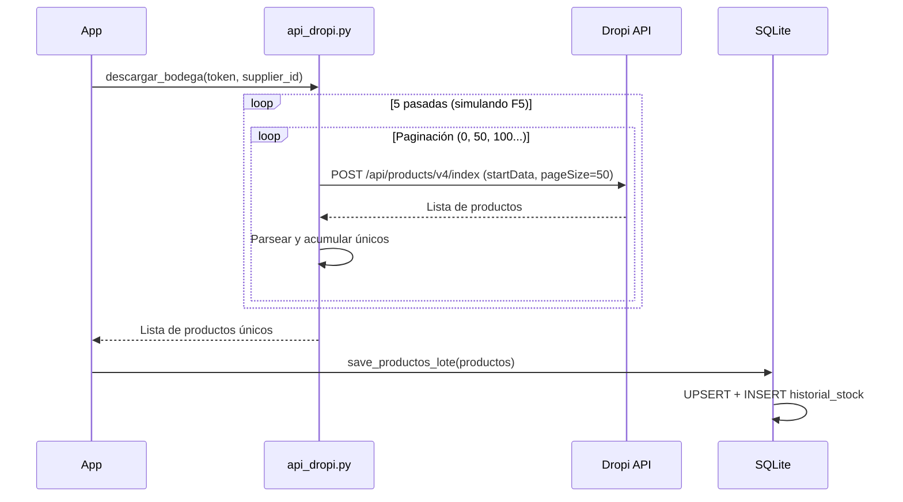
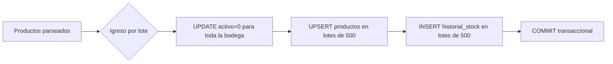
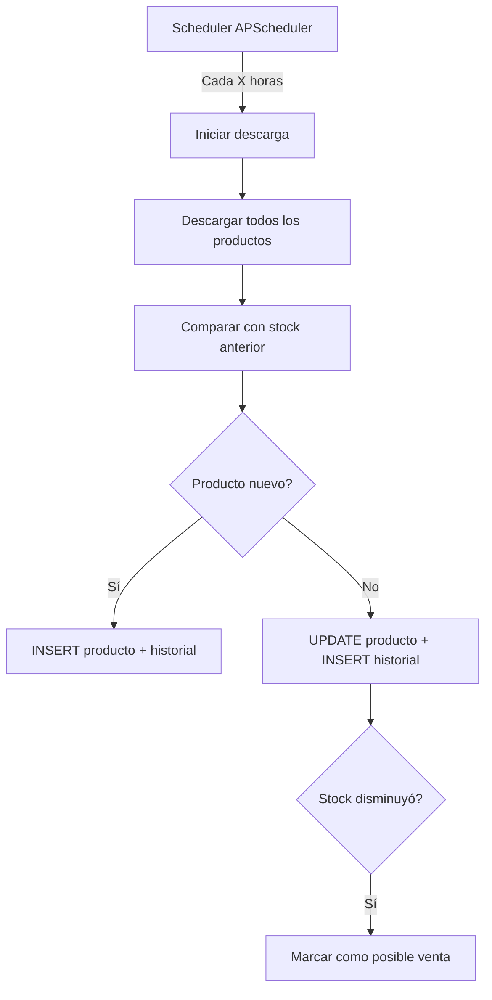
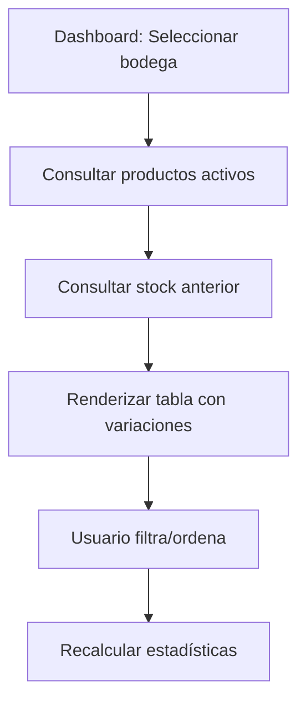
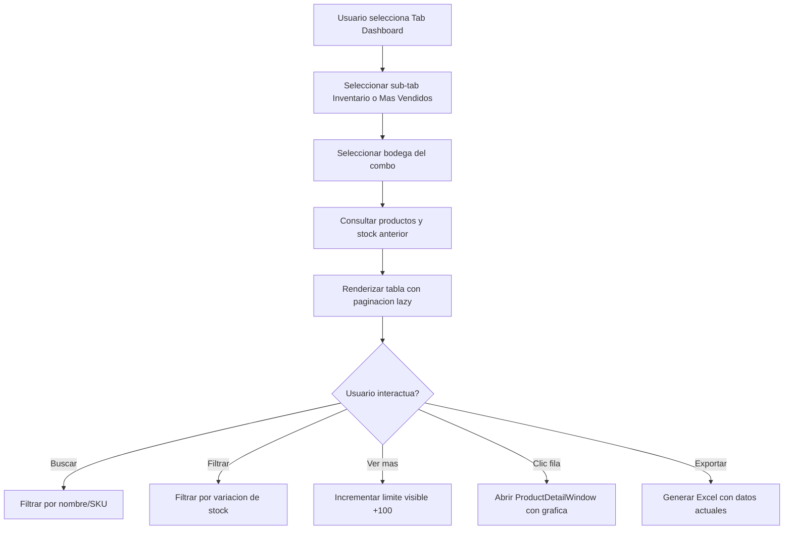
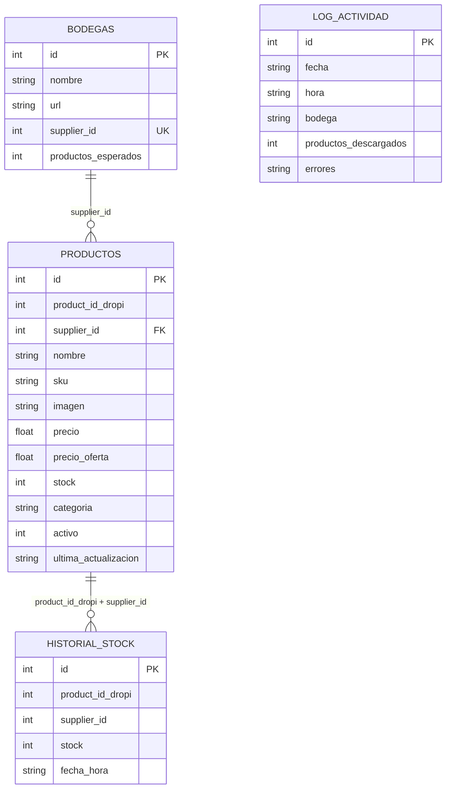
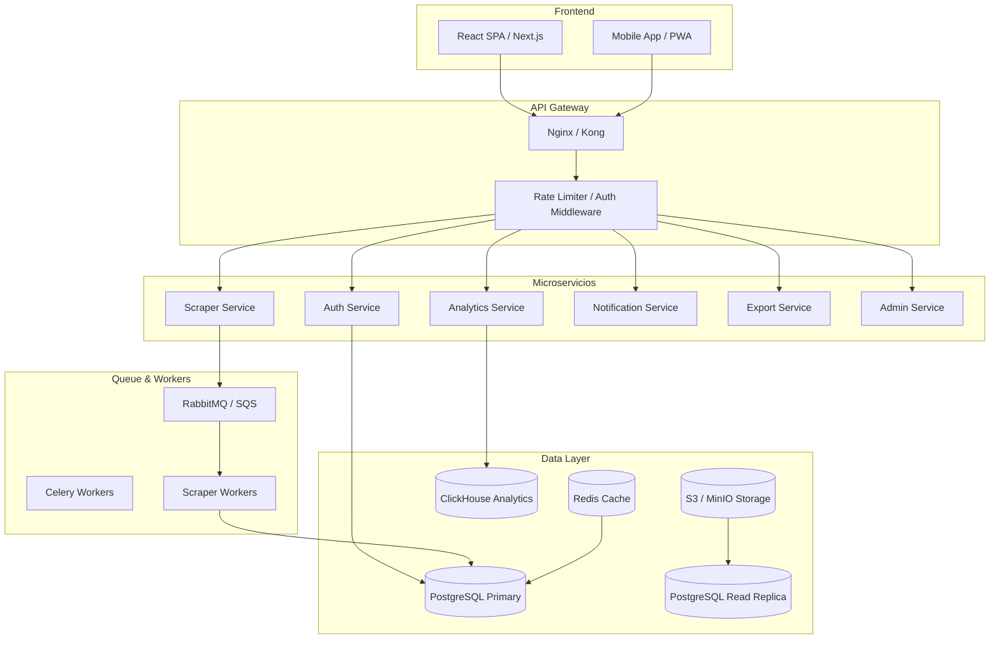

# AUDITORÍA TÉCNICA COMPLETA DROPI TRACKER

> Documento generado automáticamente por auditoría de código. No modificar código fuente.

---

## FASE 1 — INVENTARIO GENERAL

### 1.1 Árbol de Carpetas

```
dropi_tracker/
├── app.py                  # Aplicación principal (UI CustomTkinter)
├── api_dropi.py            # Cliente HTTP para API de Dropi
├── database.py             # Acceso a datos SQLite
├── models.py               # Modelos de datos (dataclasses)
├── dashboard.py            # Componentes visuales del dashboard
├── scheduler.py            # Planificador de tareas con APScheduler
├── settings.py             # Gestión de configuración JSON
├── export_excel.py         # Exportación a Excel
├── test_suite.py           # Suite de pruebas unitarias
├── test_login.py           # Prueba de login contra API Dropi
├── requirements.txt        # Dependencias Python
├── settings.json           # Configuración local con credenciales
├── dropi_tracker.db        # Base de datos SQLite
├── install.bat             # Script de instalación
├── run.bat                 # Script de ejecución
├── scratch/                # Scripts de diagnóstico y pruebas
│   ├── check_db_fields.py
│   ├── diag_api.py
│   ├── diag_db.py
│   ├── find_missing_methods.py
│   ├── print_full_prod.py
│   ├── search_code.py
│   ├── test_hot.py
│   ├── test_price_filter.py
│   ├── test_private.py
│   └── test_search.py
└── __pycache__/            # Caché de bytecode Python
```

### 1.2 Tecnologías Utilizadas

| Capa | Tecnología | Versión | Propósito |
|------|-----------|---------|-----------|
| **UI** | CustomTkinter | >=5.2.0 | Interfaz gráfica moderna y customizable |
| **HTTP** | requests | >=2.31.0 | Consumo de API REST Dropi |
| **DB** | SQLite (stdlib) | - | Persistencia local de datos |
| **Scheduling** | APScheduler | >=3.10.4 | Tareas programadas en background |
| **Data** | pandas | >=2.0.0 | Manipulación y exportación de datos |
| **Excel** | openpyxl | >=3.1.0 | Generación de archivos .xlsx |
| **Charts** | matplotlib | >=3.7.0 | Gráficos de evolución de stock |
| **Images** | Pillow | >=10.0.0 | Carga y renderizado de imágenes |

### 1.3 Dependencias y Librerías

```
customtkinter>=5.2.0
requests>=2.31.0
apscheduler>=3.10.4
pandas>=2.0.0
openpyxl>=3.1.0
matplotlib>=3.7.0
Pillow>=10.0.0
```

### 1.4 Variables de Entorno / Configuración

Archivo `settings.json`:
- `email`: Correo de login Dropi
- `password`: Contraseña de login Dropi
- `token`: JWT cacheado
- `horarios`: Horarios de descarga automática (`08:00`, `12:00`, `18:00`, `00:00`)

### 1.5 APIs Utilizadas

| Endpoint | Método | Propósito |
|----------|--------|-----------|
| `https://api.dropi.co/api/login` | POST | Autenticación y obtención de token JWT |
| `https://api.dropi.co/api/products/v4/index` | POST | Listado de productos de un supplier |

### 1.6 Servicios Externos

- **Dropi API v4**: Plataforma colombiana de dropshipping (app.dropi.co)
- **CloudFront CDN**: `d39ru7awumhhs2.cloudfront.net` — imágenes de productos

### 1.7 Archivos Críticos

| Archivo | Críticidad | Descripción |
|---------|-----------|-------------|
| `settings.json` | ALTA | Contiene credenciales de acceso a Dropi |
| `dropi_tracker.db` | ALTA | Base de datos SQLite con toda la información |
| `api_dropi.py` | ALTA | Lógica de comunicación con API |
| `database.py` | ALTA | Persistencia y modelo de datos |
| `app.py` | MEDIA | Interfaz de usuario |

---

## FASE 2 — FLUJO GENERAL

### 2.1 Inicio de la Aplicación

```mermaid
flow浃flowchart TD
    A[Usuario ejecuta app.py] --> B[Inicializar SQLite: init_db]
    B --> C[Cargar settings.json]
    C --> D[Iniciar APScheduler con horarios]
    D --> E[Construir UI CustomTkinter]
    E --> F[Iniciar polling de cola UI]
    F --> G[App lista para uso]
```

### 2.2 Flujo de Autenticación



### 2.3 Flujo de Scraping



### 2.4 Flujo de Almacenamiento



### 2.5 Flujo de Actualización



### 2.6 Flujo de Procesamiento de Datos



### 2.7 Flujo de Visualización



---

## FASE 3 — SCRAPERS (api_dropi.py)

### 3.1 Identificación del Scraper

| Atributo | Valor |
|----------|-------|
| **URL Objetivo** | `https://api.dropi.co/api/products/v4/index` |
| **URL Login** | `https://api.dropi.co/api/login` |
| **Método de Autenticación** | JWT via header `X-Authorization: Bearer <token>` |
| **Método HTTP** | POST |
| **Content-Type** | `application/json` |

### Headers Base

```python
_BASE_HEADERS = {
    "Accept": "application/json, text/plain, */*",
    "Accept-Language": "es-419,es;q=0.9",
    "Content-Type": "application/json",
    "Origin": "https://app.dropi.co",
    "Referer": "https://app.dropi.co/",
    "User-Agent": "Mozilla/5.0 ... Chrome/124.0.0.0",
    "Sec-Fetch-Dest": "empty",
    "Sec-Fetch-Mode": "cors",
    "Sec-Fetch-Site": "same-site",
}
```

### Payload de Productos

```json
{
  "country": "COLOMBIA",
  "favorite": false,
  "get_stock": true,
  "no_count": true,
  "pageSize": 50,
  "privated_product": false,
  "search_type": "simple",
  "startData": 0,
  "supplier_id": <supplier_id>,
  "userVerified": false,
  "with_collection": true
}
```

### 3.2 Paginación

- **Tipo**: Offset-based (`startData`)
- **Page size**: 50 productos
- **Máximo de páginas**: 1000 (soporte hasta 50,000 productos)
- **Rate limit**: 0.12 segundos entre páginas (`REQUEST_DELAY`)
- **Estrategia**: Emula scroll "Mostrar más productos" de la UI web. Se repiten hasta 5 pasadas (F5) para compensar el shuffle del catálogo por parte de Dropi.

### 3.3 Estrategia Anti-Bloqueo

1. **User-Agent realista**: Chrome 124 en Windows
2. **Headers de CORS**: Origin, Referer, Sec-Fetch-*
3. **Rate limiting**: 0.12s entre páginas (~8.3 req/s)
4. **Reintentos**: 3 intentos con backoff exponencial (`2^attempt`)
5. **Nueva sesión HTTP por pasada**: Emula F5/recarga de página
6. **Token refresh automático**: Si recibe 401/403, reintenta login

### 3.4 Manejo de Errores

- **401/403**: Lanza `PermissionError` → App reintenta login
- **Timeout**: Reintento con backoff
- **RequestException**: Reintento, luego aborta pasada
- **Cancelación**: `threading.Event` para detener descarga en curso

### 3.5 Datos Extraídos por Producto

| Campo | Fuente API Dropi |
|-------|-----------------|
| product_id_dropi | `id` |
| supplier_id | Parámetro de búsqueda |
| nombre | `name` |
| sku | `sku` / `reference` |
| imagen | `gallery[0].urlS3` → CloudFront |
| precio | `sale_price` ?? `price` |
| precio_oferta | `suggested_price` ?? `price_offer` |
| stock | `warehouse_product` → `variations` → `stock` |
| categoria | `categories[].name` → `category.name` |

### 3.6 Entrada-Proceso-Salida

```
ENTRADA:
  - token JWT (string)
  - supplier_id (int)
  - productos_esperados (int, opcional)
  - stop_event (threading.Event, opcional)

PROCESO:
  1. Normalizar token (Bearer)
  2. Para cada pasada (1-5):
     a. Crear nueva sesion HTTP
     b. Paginar hasta que API devuelva 0 items
     c. Parsear cada producto y acumular unicos
     d. Si alcanza productos_esperados → terminar
  3. Si no hay productos en total → abortar

SALIDA:
  - List[Producto] — lista de productos únicos
```

---

## FASE 4 — BASE DE DATOS

### 4.1 Tablas

#### `bodegas`
| Campo | Tipo | Constraint |
|-------|------|-----------|
| id | INTEGER | PK AUTOINCREMENT |
| nombre | TEXT | NOT NULL |
| url | TEXT | |
| supplier_id | INTEGER | UNIQUE NOT NULL |
| productos_esperados | INTEGER | DEFAULT 0 |

#### `productos`
| Campo | Tipo | Constraint |
|-------|------|-----------|
| id | INTEGER | PK AUTOINCREMENT |
| product_id_dropi | INTEGER | NOT NULL |
| supplier_id | INTEGER | NOT NULL |
| nombre | TEXT | |
| sku | TEXT | |
| imagen | TEXT | |
| precio | REAL | |
| precio_oferta | REAL | |
| stock | INTEGER | |
| categoria | TEXT | |
| activo | INTEGER | DEFAULT 1 |
| ultima_actualizacion | TEXT | |
| **UNIQUE** | (product_id_dropi, supplier_id) | |

#### `historial_stock`
| Campo | Tipo | Constraint |
|-------|------|-----------|
| id | INTEGER | PK AUTOINCREMENT |
| product_id_dropi | INTEGER | NOT NULL |
| supplier_id | INTEGER | NOT NULL |
| stock | INTEGER | |
| fecha_hora | TEXT | NOT NULL |

#### `log_actividad`
| Campo | Tipo | Constraint |
|-------|------|-----------|
| id | INTEGER | PK AUTOINCREMENT |
| fecha | TEXT | |
| hora | TEXT | |
| bodega | TEXT | |
| productos_descargados | INTEGER | |
| errores | TEXT | |

### 4.2 Índices

```sql
-- Historial
CREATE INDEX idx_hist_prod ON historial_stock(product_id_dropi, supplier_id);
CREATE INDEX idx_hist_fecha ON historial_stock(fecha_hora);
CREATE INDEX idx_hist_supp_fecha ON historial_stock(supplier_id, fecha_hora);

-- Productos
CREATE INDEX idx_prod_supplier ON productos(supplier_id, activo);
```

### 4.3 Diagrama ER (Mermaid)



---

## FASE 5 — LÓGICA DE NEGOCIO

### 5.1 Detección de Nueva Bodega

- El usuario ingresa URL o supplier_id manual
- Se extrae supplier_id de la URL con regex
- Se valida que no exista ya en `bodegas` (constraint UNIQUE)
- Si es nuevo: INSERT en tabla `bodegas`

### 5.2 Detección de Producto Nuevo

- En cada descarga, se hace UPSERT con `INSERT ... ON CONFLICT ... DO UPDATE`
- El campo `activo` se marca a 1 para productos descargados
- Si un producto no aparece en la descarga → `activo=0` (mediante `marcar_inactivos()`)

### 5.3 Actualización de Productos

- **Si existe**: UPDATE de nombre, sku, imagen, precio, precio_oferta, stock, categoria, activo=1, ultima_actualizacion
- **Si no existe**: INSERT completo
- **Siempre**: INSERT en `historial_stock` con timestamp

### 5.4 Detección de Cambios (Stock)

- Se consulta `get_stock_anterior()` → devuelve stock del reporte anterior
- Se compara stock actual vs anterior
- Si `stock_anterior > stock_actual` → posible venta
- Si `stock_anterior < stock_actual` → reposición

### 5.5 Generación de Estadísticas

- **Dashboard**: Total productos, bajadas, subidas (comparación con reporte anterior)
- **Productos calientes**: `COALESCE(h_old.stock, p.stock) - p.stock` → ventas estimadas
- **Ranking**: ORDER BY ventas_estimadas DESC

### 5.6 Almacenamiento de Históricos

- Cada descarga genera un snapshot completo de stock en `historial_stock`
- Limitado a 120 registros por producto en consulta
- Índice por fecha_hora para queries rápidas

---

## FASE 6 — AUTOMATIZACIONES

### 6.1 Cron Jobs / Tareas Programadas

| Horario | Frecuencia | Acción |
|---------|-----------|--------|
| 08:00 | Diaria | Descarga automática |
| 12:00 | Diaria | Descarga automática |
| 18:00 | Diaria | Descarga automática |
| 00:00 | Diaria | Descarga automática |

Implementado con `APScheduler` (BackgroundScheduler) que ejecuta `on_trigger` callback.

### 6.2 Workers y Procesos

- **Descarga**: Ejecutada en thread separado (`_run_in_thread()`)
- **Carga de imágenes**: Threads en background (`_load_image_async()`)
- **Scheduler**: Daemon thread de APScheduler
- **Stop Event**: `threading.Event` para cancelación controlada

### 6.3 Colas

- `_ui_queue`: Cola `queue.Queue` para comunicación thread-safe entre worker de descarga y UI main thread

---

## FASE 7 — FRONTEND

### 7.1 Páginas/Tabs

| Tab | Contenido |
|-----|-----------|
| **⚙ Configuración** | Credenciales, bodegas, horarios |
| **⬇ Descargar** | Botón de descarga manual, log de actividad |
| **📊 Dashboard** | Inventario + Productos más vendidos |
| **📋 Historial** | Log de actividades de descarga |

### 7.2 Componentes Principales (dashboard.py)

| Componente | Descripción |
|-----------|-------------|
| `ProductRow` | Fila de producto con imagen, nombre, SKU, stock actual/anterior, ventas |
| `DashboardTable` | Tabla scrollable con filtrado y búsqueda (lazy load 100 filas) |
| `HotProductRow` | Fila de producto caliente con rank, bodega, ventas estimadas |
| `HotDashboardTable` | Tabla de productos más vendidos |
| `ProductDetailWindow` | Ventana emergente con gráfica y tabla de historial |

### 7.3 Funciones Disponibles

- **Configuración**: Agregar/Editar/Eliminar bodegas, guardar credenciales, probar login
- **Descarga**: Descargar ahora, detener, exportar Excel
- **Dashboard**: Filtrar por bodega, buscar por nombre/SKU, filtrar variación (bajaron/subieron), exportar inventario caliente
- **Historial**: Ver log de actividades

---

## FASE 8 — SEGURIDAD

### 8.1 Riesgos Identificados

| Riesgo | Severidad | Descripción |
|--------|-----------|-------------|
| **Credenciales en texto plano** | ALTA | Email y password almacenados en `settings.json` sin cifrado |
| **Token JWT en disco** | ALTA | Token de sesión almacenado sin protección |
| **Sin autenticación local** | MEDIA | Cualquier usuario del sistema operativo puede acceder |
| **SQLite single-threaded** | BAJA | WAL habilitado pero potencial de race conditions |
| **Sin HTTPS pinning** | BAJA | No verifica certificado de Dropi API |

### 8.2 Datos Sensibles

- `settings.json` → Email, contraseña, token JWT (TODO: cifrar con keyring)

### 8.3 Vulnerabilidades

- **CWE-312**: Credenciales almacenadas en texto claro
- **CWE-522**: Sin autenticación de la aplicación misma
- **CWE-200**: Información potencialmente sensible en logs

### 8.4 Cuellos de Botella

- **SQLite**: No escala bien para miles de productos o usuarios concurrentes
- **Single-threaded UI**: Todo el procesamiento pesado en background threads
- **Sin tearing**: Sin separación frontend/backend

### 8.5 Problemas de Escalabilidad

| Problema | Impacto |
|----------|---------|
| Base de datos SQLite local | No multiusuario, no distribuido |
| Sin servicio web | No accesible desde móvil/remoto |
| Sin API propia | Acoplada a UI de escritorio |
| Sin colas de procesamiento | Descargas bloqueantes en la UI |
| Sin caché | Consultas repetidas a SQLite |

---

# PARTE 2: ARQUITECTURA SAAS PROPUESTA

## 9.1 Arquitectura General Cloud



## 9.2 Sistema de Usuarios y Permisos

### Roles

| Rol | Permisos |
|-----|----------|
| **Usuario Normal** | Ver sus bodegas, productos, históricos. Limitado por plan. |
| **Usuario Agencia** | Múltiples bodegas, múltiples cuentas, exportaciones avanzadas |
| **Super Admin** | Ver todo el sistema, impersonar, estadísticas globales, tendencias, logs |

### Tablas de Permisos (SaaS)

```sql
CREATE TABLE tenants (id UUID PK, nombre TEXT, plan TEXT, max_bodegas INT);
CREATE TABLE users (id UUID PK, tenant_id FK, email TEXT, rol ENUM('normal','agency','admin'));
CREATE TABLE user_bodegas (user_id FK, supplier_id FK);
CREATE TABLE planes (id PK, nombre TEXT, max_bodegas INT, max_productos INT, precio DECIMAL);
```

## 9.3 Módulo de Inteligencia

| Feature | Implementación |
|---------|---------------|
| Cruzar información | JOINs cross-tenant (solo admin) |
| Productos ganadores | Ranking por ventas_estimadas global |
| Tendencias | Análisis de variance en N días (ClickHouse) |
| Velocidad de ventas | Derivada de stock(t) - stock(t-Δt) |
| Competencia | Productos similares entre bodegas |
| Rankings | Materialized views actualizadas cada hora |

## 9.4 Tecnologías Cloud Propuestas

| Capa | Tecnología | Razón |
|------|-----------|-------|
| **Frontend** | Next.js / React | SSR, SEO, SPA |
| **API** | FastAPI / Node.js | Alto performance, async |
| **DB Principal** | PostgreSQL | ACID, JSONB, full-text search |
| **DB Analytics** | ClickHouse | Agregaciones rápidas, time-series |
| **Cache** | Redis | Sesiones, rate limiting, hot data |
| **Queue** | RabbitMQ / Redis Queue | Tareas asíncronas |
| **Workers** | Celery + Python | Scrapers en background |
| **Storage** | S3 / MinIO | Imágenes, exportaciones |
| **WebSockets** | Socket.io / WS | Notificaciones en tiempo real |
| **Infra** | Docker / Kubernetes | Escalabilidad, orquestación |

## 9.5 Roadmap de Migración

| Fase | Duración | Actividades |
|------|----------|-------------|
| **Fase 1** | 2 sem | Diseño de API REST, modelos de datos, autenticación |
| **Fase 2** | 3 sem | Migración de lógica de scraping a microservicio + colas |
| **Fase 3** | 3 sem | Desarrollo del frontend web (React) |
| **Fase 4** | 2 sem | Panel de administración maestro |
| **Fase 5** | 2 sem | Módulo de inteligencia y analytics |
| **Fase 6** | 2 sem | Pruebas de carga, optimización, seguridad |
| **Fase 7** | 1 sem | Migración de datos SQLite → PostgreSQL |
| **Fase 8** | 2 sem | Beta cerrada, feedback, iteraciones |
| **Total** | **19 sem** | ~5 meses |

---

*Fin del documento de auditoría y diseño.*
