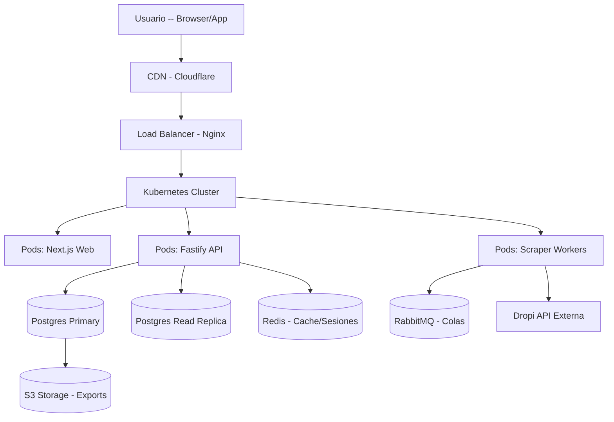

# SECCION 7: OPENAPI DEL SISTEMA NUEVO (Dropi Tracker SaaS)

## 7.1 Especificacion OpenAPI 3.0.3

```yaml
openapi: 3.0.3
info:
  title: Dropi Tracker SaaS API
  version: 2.0.0
  description: API REST para plataforma SaaS de tracking de productos Dropi

servers:
  - url: https://api.dropitracker.com/v2
    description: Produccion
  - url: http://localhost:8000/v2
    description: Desarrollo

paths:
  # ============================ AUTENTICACION ============================
  /auth/register:
    post:
      summary: Registrar nuevo usuario
      tags: [Auth]
      requestBody:
        required: true
        content:
          application/json:
            schema:
              type: object
              properties:
                email: { type: string, format: email }
                password: { type: string, minLength: 8 }
                company_name: { type: string }
                plan: { type: string, enum: [basic, pro, agency, enterprise] }
      responses:
        201:
          description: Usuario creado
          content:
            application/json:
              schema:
                $ref: '#/components/schemas/AuthResponse'

  /auth/login:
    post:
      summary: Iniciar sesion
      tags: [Auth]
      requestBody:
        required: true
        content:
          application/json:
            schema:
              type: object
              properties:
                email: { type: string }
                password: { type: string }
      responses:
        200:
          description: Login exitoso
          content:
            application/json:
              schema:
                $ref: '#/components/schemas/AuthResponse'

  /auth/refresh:
    post:
      summary: Refrescar token
      tags: [Auth]
      security: [ bearerAuth: [] ]
      responses:
        200:
          description: Token refrescado

  # ============================ BODEGAS ============================
  /warehouses:
    get:
      summary: Listar bodegas del usuario
      tags: [Bodegas]
      security: [ bearerAuth: [] ]
      responses:
        200:
          description: Lista de bodegas
          content:
            application/json:
              schema:
                type: array
                items:
                  $ref: '#/components/schemas/Bodega'

    post:
      summary: Agregar bodega
      tags: [Bodegas]
      security: [ bearerAuth: [] ]
      requestBody:
        required: true
        content:
          application/json:
            schema:
              type: object
              properties:
                nombre: { type: string }
                url: { type: string, format: uri }
                supplier_id: { type: integer }
                productos_esperados: { type: integer, default: 0 }
      responses:
        201:
          description: Bodega creada

  /warehouses/{id}:
    get:
      summary: Obtener bodega
      tags: [Bodegas]
      security: [ bearerAuth: [] ]
      parameters:
        - { name: id, in: path, required: true, schema: { type: integer } }
      responses:
        200:
          description: Bodega

    put:
      summary: Actualizar bodega
      tags: [Bodegas]
      security: [ bearerAuth: [] ]
      parameters:
        - { name: id, in: path, required: true, schema: { type: integer } }
      requestBody:
        content:
          application/json:
            schema:
              $ref: '#/components/schemas/Bodega'
      responses:
        200:
          description: Bodega actualizada

    delete:
      summary: Eliminar bodega
      tags: [Bodegas]
      security: [ bearerAuth: [] ]
      parameters:
        - { name: id, in: path, required: true, schema: { type: integer } }
      responses:
        204:
          description: Bodega eliminada

  # ============================ PRODUCTOS ============================
  /warehouses/{id}/products:
    get:
      summary: Listar productos de una bodega
      tags: [Productos]
      security: [ bearerAuth: [] ]
      parameters:
        - { name: id, in: path, required: true, schema: { type: integer } }
        - { name: page, in: query, schema: { type: integer, default: 1 } }
        - { name: per_page, in: query, schema: { type: integer, default: 50 } }
        - { name: search, in: query, schema: { type: string } }
        - { name: filter, in: query, schema: { enum: [all, decreased, increased] } }
      responses:
        200:
          description: Lista de productos paginada
          content:
            application/json:
              schema:
                type: object
                properties:
                  data: { type: array, items: { $ref: '#/components/schemas/Producto' } }
                  total: { type: integer }
                  page: { type: integer }
                  per_page: { type: integer }

  /products/{id}/history:
    get:
      summary: Obtener historial de un producto
      tags: [Productos]
      security: [ bearerAuth: [] ]
      parameters:
        - { name: id, in: path, required: true, schema: { type: integer } }
        - { name: limit, in: query, schema: { type: integer, default: 120 } }
      responses:
        200:
          description: Historial de stock

  # ============================ REPORTES ============================
  /reports/hot-products:
    get:
      summary: Productos mas vendidos
      tags: [Reportes]
      security: [ bearerAuth: [] ]
      parameters:
        - { name: hours, in: query, schema: { type: integer, enum: [ shortest: 24, 48, 72, 168 ], default: 24 } }
      responses:
        200:
          description: Ranking de productos calientes

  /reports/export:
    post:
      summary: Exportar reporte a Excel
      tags: [Reportes]
      security: [ bearerAuth: [] ]
      requestBody:
        content:
          application/json:
            schema:
              type: object
              properties:
                type: { type: string, enum: [inventory, history, hot, full] }
                warehouse_id: { type: integer }
                format: { type: string, enum: [xlsx, csv], default: xlsx }
      responses:
        200:
          description: URL del archivo generado

  # ============================ SCRAPING ============================
  /scraping/trigger:
    post:
      summary: Iniciar descarga manual
      tags: [Scraping]
      security: [ bearerAuth: [] ]
      requestBody:
        content:
          application/json:
            schema:
              type: object
              properties:
                warehouse_ids: { type: array, items: { type: integer } }
      responses:
        202:
          description: Descarga encolada (AsyncTask)
          content:
            application/json:
              schema:
                type: object
                properties:
                  job_id: { type: string }
                  status: { type: string }

  /scraping/status/{job_id}:
    get:
      summary: Consultar estado de descarga
      tags: [Scraping]
      security: [ bearerAuth: [] ]
      parameters:
        - { name: job_id, in: path, required: true, schema: { type: string } }
      responses:
        200:
          description: Estado del job

  # ============================ ADMIN ============================
  /admin/statistics:
    get:
      summary: Estadisticas globales (solo admin)
      tags: [Admin]
      security: [ bearerAuth: [] ]
      responses:
        200:
          description: Datos globales del SaaS

  /admin/users:
    get:
      summary: Listar todos los usuarios (solo admin)
      tags: [Admin]
      security: [ bearerAuth: [] ]
      responses:
        200:
          description: Lista de usuarios

  /admin/impersonate/{user_id}:
    post:
      summary: Impersonar usuario (solo admin)
      tags: [Admin]
      security: [ bearerAuth: [] ]
      parameters:
        - { name: user_id, in: path, required: true, schema: { type: string, format: uuid } }
      responses:
        200:
          description: Token de sesion del usuario impersonado

components:
  securitySchemes:
    bearerAuth:
      type: http
      scheme: bearer
      bearerFormat: JWT

  schemas:
    AuthResponse:
      type: object
      properties:
        token: { type: string }
        refresh_token: { type: string }
        user: { $ref: '#/components/schemas/User' }

    User:
      type: object
      properties:
        id: { type: string, format: uuid }
        email: { type: string }
        nombre: { type: string }
        rol: { type: string, enum: [user, agency, admin] }
        plan: { type: string }
        company_id: { type: string, format: uuid }

    Bodega:
      type: object
      properties:
        id: { type: integer }
        nombre: { type: string }
        url: { type: string }
        supplier_id: { type: integer }
        productos_esperados: { type: integer }
        ultima_sincronizacion: { type: string, format: date-time }

    Producto:
      type: object
      properties:
        id: { type: integer }
        product_id_dropi: { type: integer }
        supplier_id: { type: integer }
        nombre: { type: string }
        sku: { type: string }
        imagen: { type: string }
        precio: { type: number }
        precio_oferta: { type: number }
        stock: { type: integer }
        categoria: { type: string }
        activo: { type: boolean }
        ultima_actualizacion: { type: string, format: date-time }
```

---

# SECCION 8: ARQUITECTURA SAAS MULTI-TENANT

## 8.1 Estrategia de Aislamiento: Row-Level Security (RLS)

Utilizaremos RLS sobre PostgreSQL para garantizar que cada empresa solo vea sus propios datos sin cambios de arquitectura complejos.

```sql
-- Tabla de Empresas
CREATE TABLE companies (
    id UUID PRIMARY KEY DEFAULT gen_random_uuid(),
    name TEXT NOT NULL,
    subdomain TEXT UNIQUE,
    stripeId TEXT,
    plan TEXT NOT NULL DEFAULT 'basic', -- basic, pro, agency, enterprise
    max_warehouses INT DEFAULT 5,
    max_scraping_per_day INT DEFAULT 20,
    max_users INT DEFAULT 3,
    is_active BOOLEAN DEFAULT true,
    created_at TIMESTAMPTZ DEFAULT NOW()
);

-- Tabla de Usuarios
CREATE TABLE users (
    id UUID PRIMARY KEY DEFAULT gen_random_uuid(),
    company_id UUID NOT NULL REFERENCES companies(id) ON DELETE CASCADE,
    email TEXT UNIQUE NOT NULL,
    password_hash TEXT NOT NULL,
    full_name TEXT,
    role TEXT DEFAULT 'user', -- user, agency, admin, super_admin
    email_verified_at TIMESTAMPTZ,
    last_login_at TIMESTAMPTZ,
    created_at TIMESTAMPTZ DEFAULT NOW()
);

-- Tabla de Bodegas (Multi-Tenant)
CREATE TABLE warehouses (
    id UUID PRIMARY KEY DEFAULT gen_random_uuid(),
    company_id UUID NOT NULL REFERENCES companies(id) ON DELETE CASCADE,
    nombre TEXT NOT NULL,
    url TEXT,
    supplier_id INT NOT NULL,
    productos_esperados INT DEFAULT 0,
    created_at TIMESTAMPTZ DEFAULT NOW()
);

-- Tabla de Productos (Multi-Tenant)
CREATE TABLE products (
    id UUID PRIMARY KEY DEFAULT gen_random_uuid(),
    company_id UUID NOT NULL REFERENCES companies(id) ON DELETE CASCADE,
    warehouse_id UUID NOT NULL REFERENCES warehouses(id) ON DELETE CASCADE,
    product_id_dropi INT NOT NULL,
    nombre TEXT,
    sku TEXT,
    imagen TEXT,
    precio DECIMAL(10,2),
    precio_oferta DECIMAL(10,2),
    stock INT,
    categoria TEXT,
    activo BOOLEAN DEFAULT true,
    ultima_actualizacion TIMESTAMPTZ DEFAULT NOW()
);

-- Tabla de Historial (Multi-Tenant)
CREATE TABLE stock_history (
    id UUID PRIMARY KEY DEFAULT gen_random_uuid(),
    company_id UUID NOT NULL REFERENCES companies(id) ON DELETE CASCADE,
    product_id UUID NOT NULL,
    stock INT,
    date TIMESTAMPTZ DEFAULT NOW()
);

-- Habilitar RLS
ALTER TABLE warehouses ENABLE ROW LEVEL SECURITY;
ALTER TABLE products ENABLE ROW LEVEL SECURITY;
ALTER TABLE stock_history ENABLE ROW LEVEL SECURITY;

CREATE POLICY "company_access_warehouses"
    ON warehouses USING (company_id = current_setting('app.current_company_id')::UUID);

CREATE POLICY "company_access_products"
    ON products USING (company_id = current_setting('app.current_company_id')::UUID);
```

---

# SECCION 9: SISTEMA MAESTRO (SUPER ADMIN)

El administrador del sistema (super admin) necesita una capa de acceso total sobre la plataforma. Para esto, se propone un servicio de administración separado que evade las políticas de RLS y accede directo a la base de datos para reportar y controlar.

## 9.1 Funcionalidades Principales

- **Panel de Control Maestro (`/admin/dashboard`):**
  - Estadísticas globales: Total de bodegas, productos sincronizados, usuarios activos, créditos consumidos y productos más vendidos en la plataforma.
  - Mapa de Calor (Heatmap): Visualizar la actividad sincronizada por hora para detectar picos.
  
- **Gestor de Usuario Maestro:**
  - `GET /admin/users`: Obtiene listado paginado de todos los usuarios registrados.
  - **Impersonar:** Un super admin puede hacer clic en cualquier usuario para ver exactamente como lo ve él.
  - **Gestor de Empresas:** Bloquear, suspender o cambiar el plan de una empresa.

- **Inteligencia Global (Cruzado):**
  - **Productos Ganadores Globales:** Una query que agrupe `stock_history` de todas las empresas para detectar el SKU con `stock_previous - stock_current` más alto globalmente.
  - **Predicciones de Tendencia:** Utilizar una función nativa de PostgreSQL para `linear regression` o series temporales para predecir desabastecimiento.

- **Monitor de Logs y Sistema:**
  - Integrar un consumidor de logs de los workers para identificar fallos masivos de scraping o IPs bloqueadas por Dropi.

---

# SECCION 10: DISEÑO DE ESCALABILIDAD

Para soportar la carga de miles de usuarios, millones de registros y una alta cantidad de peticiones, se propone la siguiente infraestructura y arquitectura.

## 10.1 Arquitectura de Infraestructura



| Componente | Tecnología | Rol |
|------------|------------|-----|
| **Frontend** | Next.js + Tailwind CSS | UI PWA, responsive, SSR. |
| **API Gateway** | Fastify (Node.js) | BFF para endpoints, autenticación y rate-limiting. |
| **Bases de Datos** | PostgreSQL (Prisma/Supabase) | Transacciones, historial, RLS. |
| **Base de Datos Espejo** | CockroachDB (Lectura) | Análisis pesados, agregaciones masivas de datos. |
| **Caché** | Redis | Sesiones de usuario, almacenamiento de dashboards recientes, datos de sincronización activa. |
| **Colas de Mensajes** | RabbitMQ / Bull (Node.js) | Encolar trabajos de scraping largos para evitar el bloqueo de la API. |
| **Workers** | Celery/Python o BullMQ/Node.js | Ejecutores físicos de los procesos de scraping. Un worker por núcleo. |
| **Notificaciones** | WebSockets (Socket.io) | Canal de comunicación para emitir el progreso de una sincronización en tiempo real a la UI. |
| **Contenedores** | Docker + Kubernetes (K8s) | Orquestación, auto-escalado, auto-recuperación de pods. |
## 10.2 Flujo de Datos y Escalabilidad

1.  **Petición Concurrente:** Fastify maneja miles de peticiones concurrentes gracias a su modelo de event loop. Se conecta a Redis para validar si un dashboard ya fue renderizado y evitar golpear PostgreSQL.
2.  **Decoupling de Scrapers:** Cuando el usuario presiona "Sincronizar", la API de Fastify inserta un mensaje en **RabbitMQ** con el ID de la bodega y el ID del usuario. Un **Worker** libre toma el mensaje de la cola, realiza el scraping (que puede tomar segundos o minutos) y luego guarda los datos en la base de datos.
3.  **WebSockets:** El Worker publica actualizaciones de progreso (`progress=10%`, `20%`) en un canal de streaming que la UI del usuario escucha para mostrar una barra de progreso en tiempo real.
4.  **Almacenamiento Masivo:** Los snapshots de stock masivos se guardan en tablas particionadas (`stock_history`) para optimizar la velocidad de lectura. Los reportes de Excel masivos se generan en el worker y se almacenan en la base de datos con los datos en forma de Blob o en un **S3** (AWS/MinIO), enviando al usuario un link de descarga.

---

# SECCIÓN 11: PLAN EXACTO PARA RECONSTRUIR EN LOVABLE

Este plan detalla los pasos técnicos para llevar el proyecto desde la fase de diseño hasta un SaaS funcional, utilizando la especificación del proyecto, desglosándolo en un framework de desarrollo moderno y aplicando las mejores prácticas de Lovable (o un framework similar de **Next.js + Supabase**) para lograr una arquitectura eficiente y escalable.

### 1. Estructura de Carpetas del Proyecto
Se organizará siguiendo el patrón `src/` para mantener el código fuente separado de la configuración y las dependencias.

```
dropi-tracker-saas/
├── apps/
│   ├── web/                         # Next.js (Frontend de la app principal)
│   │   ├── src/
│   │   │   ├── app/                 # Sistema de rutas de Next.js
│   │   │   │   ├── [...]            # Rutas dinámicas para Bodega y Producto
│   │   │   │   ├── dashboard/
│   │   │   │   ├── bodegas/
│   │   │   │   ├── config/
│   │   │   │   ├── admin/
│   │   │   │   └── layout.tsx       # Layout principal de la app
│   │   │   ├── components/          # Componentes UI reutilizables (Shadcn)
│   │   │   │   ├── bodegas/
│   │   │   │   ├── dashboard/
│   │   │   │   └── products/
│   │   │   ├── hooks/               # Custom hooks (ej. `useAuth`, `useFetch`)
│   │   │   └── types/               # Definiciones TypeScript
│   └── api/                         # Fastify/Bun API (Backend principal)
│       ├── src/
│       │   ├── routes/              # Definición de rutas de la API
│       │   ├── controllers/         # Lógica中投更新列及逻辑 业务逻辑
│       │   ├── services/            # Lógica de scraping y procesamiento
│       │   ├── models/              # Schemas de Prisma
│       │   └── workers/             # Definición de cuegas y scraping  (Celery con Bun/Node)
│
├── packages/
│   ├── ui/                          # Librería de componentes compartidos (Shadcn)
│   ├── shared-types/                # Tipos TypeScript compartidos entre web y api
│   └── config/                      # Configuraciones de Tailwind, ESLint, etc.
│
├── infra/
│   ├── docker/                      # Dockerfiles y docker-compose
│   ├── k8s/                         # YAMLs de Kubernetes
│   └── ansible/                     # Scripts de aprovisionamiento
│
└── scanners/                        # Script standalone adaptado de api_dropi.py
    └── scraper/                     # Módulo adaptado a Turbo

```

### 2. Endpoints de la API (Fastify con Zod)
Migrar los scripts de Python a endpoints robustos en un servidor Node.js o Bun.

- `POST` /api/warehouses
  - Función: Recibe la URL o supplier_id para crear un recolección de productos.
  - Cuerpo: `{ url: string }` o `{ supplier_id: number }`.
  - Respuesta: Objeto `Warehouse` creado.

- `POST` /api/warehouses/:id/scrape
  - Función: Inicia el proceso de scraping para una bodega existente.
  - Header: `Authorization: Bearer <JWT>`.
  - Respuesta: `{ job_id: string, status: 'queued' }`.

- `GET` /api/warehouses/:id/products
  - Función: Lista de productos existentes de una bodega (paginados).
  - Parámetros de Consulta: `?page=1&limit=50&search=keyword`.

- `GET` /api/products/:id/history
  - Función: Obtiene el historial de existencias de un producto.
  - Parámetros de Consulta: `?days=7`.

- `POST` /api/auth/login
  - Función: Autentica al usuario.
  - Cuerpo: `{ email, password }`.
  - Respuesta: `{ token, refresh_token }`.

### 3. Migración del Modelo de Datos (Prisma)
Convertir el esquema SQLite actual a un esquema de PostgreSQL manejado por Prisma para aprovechar la potencia de Supabase.

- **Modelo `Company`**
  - Incluye campos: `subdomain`, `stripeId`, `plan`, `max_warehouses`, `max_products`.
  
- **Modelo `User`**
  - Campos: `companyId` (UUID -> FK a Company), `email`, `password`, `role` (`user`, `agency`, `admin`, `super_admin`).
  
- **Modelo `Warehouse`**
  - Campos actuales de `bodegas` + `companyId`.
  
- **Modelo `Product`**
  - Representa el modelo actual de la tabla `productos`.

- **Modelo `StockHistory`**
  - Representa `historial_stock` + `timestamp`.

- **Modelo `ScrapingJob`**
  - Para trackear el estado y el progreso de los procesos de scraping (Pendiente, en progreso, completado, fallido).

### 4. Componentes del Frontend (Next.js + Shadcn/UI)
Dividir la gran ventana de CustomTkinter en componentes web reutilizables.

- **Navegación:** Barra lateral (`Sidebar`) para las tabs principales (Configuración, Descargas, Dashboard, Historial).
- **Tab Dashboard:**
  - Componentes: `HotProductsTable` y `InventoryTable`.
  - Funcionalidad: Búsqueda instantánea, filtros de columna, selección de bodega.
- **Tab Configuración:**
  - Modal reutilizable para agregar/editar bodegas.
- **Panel de Detalle:**
  - Modal para el detalle del producto.
  - `LineChart` con Recharts para la gráfica de stock.
- **Notificaciones:** Toast para feedback de operaciones (ej. "Scraping iniciado", "Reporte listo").

### 5. Lógica de Scraping y Workers
Adaptar el código Python a un servicio robusto de scraping.

- **Worker Celery (Python):**
  - Copiar la lógica de `api_dropi.py` y `api_dropi.py` en un task de Celery.
  - Implementar manejo de errores para caídas de red y posibilidad de parar el proceso.
  - Estrategia de Rate-Limiting: Utilizar 0.12s entre peticiones como en el sistema original.

- **Integración con Dropdown:**
  - El frontend hace un POST a `/api/warehouses/:id/scrape` que encola el task en Celery/RabbitMQ.
  - El task actualiza una tabla `ScrapingJob` en la base de datos.
  - El frontend consume esta tabla vía polling o suscripción de tiempo real para mostrar el progreso.

- **WebSockets:**
  - Crear un handler de `socket.io` o nativo de Next.js para emitir mensajes de progreso desde el celery task al cliente.

### 6. Roadmap de Migración

| Fase | Tarea Principal | Tiempo Estimado |
| :--- | :--- | :--- |
| **1. Configuración y UI** | Crear proyecto `Turborepo` con Next.js y Fastify. Instalar Prisma y conectar a `Supabase`. Crear las tablas de la sección 11. | Semana 1 |
| **2. Auth & Core** | Implementar flujo de login con NextAuth.js y middlewares de protección de rutas. Crear el layout de la app con las 4 tabs principales. | Semana 2 |
| **3. CRUD de Bodegas** | Implementar formulario de agregar bodega (URL/SID) y tabla principal de bodegas. | Semana 3 |
| **4. Dashboard Inventario** | Crear la vista de datos de inventario con `HotProductTable` y `InventoryTable` en el frontend. | Semana 4 |
| **5. Historial y Graficas** | Integrar Recharts en el panel de detalle y crear la vista de historial de descargas. | Semana 5 |
| **6. Servicio de Scraping** | Extraer `api_dropi.py` amodule: Implementar el endpoint `/scrape` y crear el Celery worker para ejecutar la lógica. | Semana 6 |
| **7. Sistema Multi-Tenant** | Implementar la lógica de multi-tenancy en todas las tablas y endpoints. | Semana 7 |
| **8. Admin Dashboard** | Crear la vista de admin con estadísticas globales y la funcionalidad de impersonar. | Semana 8 |
| **9. Testing** | Ejecutar pruebas unitarias y de integración. Utilizar `test_suite.py` como base de los casos de prueba. | Semana 9 |
| **10. Despliegue** | Dockerizar el proyecto y desplegar en plataforma Cloud. Implementar CI/CD. | Semana 10 |

**Nota Final:** Las credenciales (email, password) deben ser manejadas por variables de entorno a nivel de API y nunca expuestas en `settings.json` del frontend. El frontend solo recibirá un token JWT del backend.
